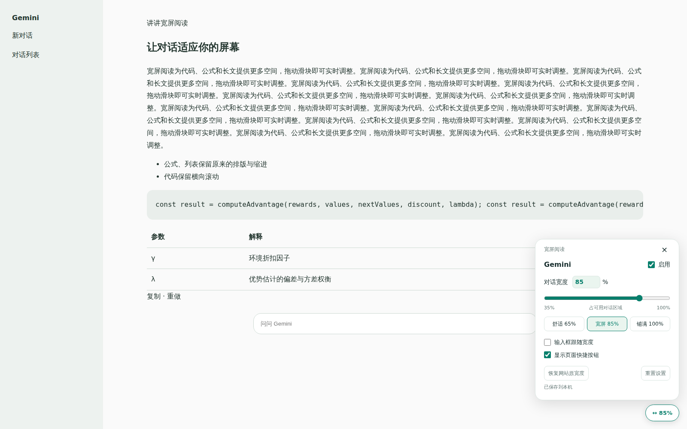
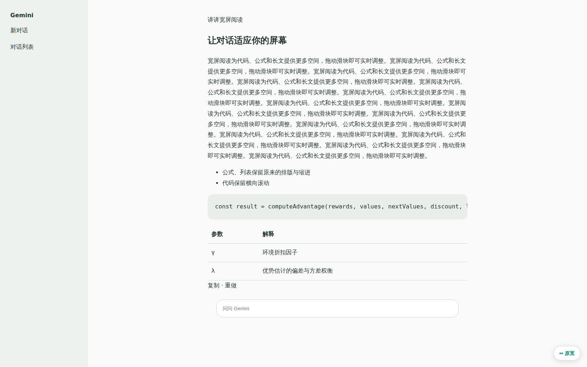
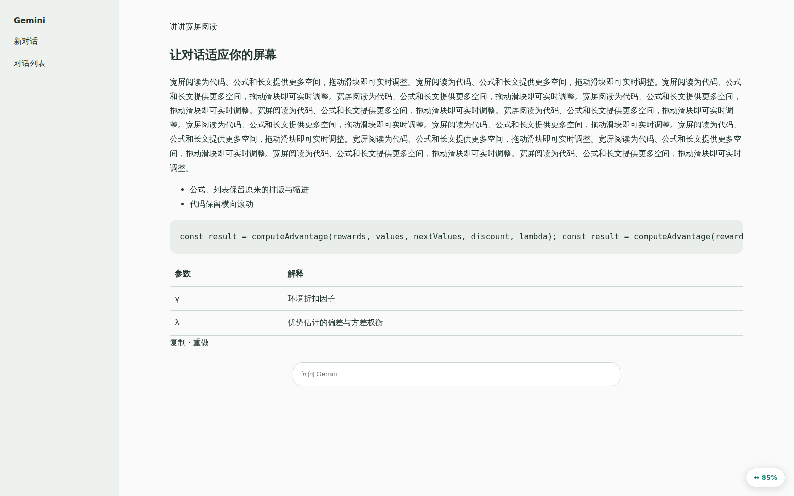
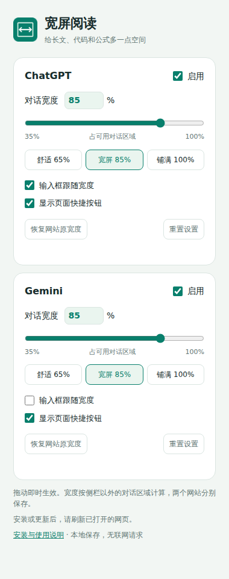

# 宽屏阅读 · ChatGPT & Gemini

让对话用上你的大屏。实时调整正文宽度，阅读长文、代码、表格和公式时少一点空白、多一点空间。

**[下载最新安装包](https://github.com/Yangxixi2023/ai-wide-reader/releases/latest/download/ai-wide-reader-v1.0.0.zip)** · **[全部版本](https://github.com/Yangxixi2023/ai-wide-reader/releases)** · MIT 开源

适用于桌面版 **Microsoft Edge / Google Chrome**。这是独立的 Manifest V3 浏览器扩展，安装无需编译、API Key、油猴或脚本猫。目前通过 GitHub 安装，尚未上架浏览器扩展商店。



> 图片使用本地模拟对话展示实际扩展效果，不包含个人聊天记录。

## 安装

1. [下载 ZIP](https://github.com/Yangxixi2023/ai-wide-reader/releases/latest/download/ai-wide-reader-v1.0.0.zip)，**完整解压到一个固定文件夹**，例如 `D:\Extensions\ai-wide-reader`。
2. 在浏览器地址栏输入扩展管理地址并回车：
   - Edge：`edge://extensions`
   - Chrome：`chrome://extensions`
3. 打开 **开发人员模式**（Chrome 名称为“开发者模式”）。
4. 点击 **加载解压缩的扩展**（Chrome 为“加载已解压的扩展程序”），选择刚刚解压的文件夹。
   - 选择的这一层应当直接包含 `manifest.json`、`content.js` 和 `icons` 文件夹。
   - 不要选择 ZIP 文件，也不要双击 `manifest.json`。
5. 刷新已打开的 [ChatGPT](https://chatgpt.com/) 或 [Gemini](https://gemini.google.com/app)。右下角出现 **↔ 85%**，安装完成。
6. 打开浏览器右上角的“扩展”菜单，把 **宽屏阅读 · ChatGPT & Gemini** 固定到工具栏，方便随时管理设置。

**安装目录请保留。** 加载解压缩扩展后，浏览器直接使用这个文件夹；移动或删除它会导致扩展失效。无需关闭浏览器原有安全保护，也无需启用用户脚本权限。

### 从源码安装

点击 GitHub 的 **Code → Download ZIP** 并解压，然后加载仓库里的 **`extension` 文件夹**。仓库根目录不是安装目录。

## 使用

- **即时调节**：点击页面右下角的 `↔ 85%`，拖动滑块，或输入 35–100 的整数。
- **常用预设**：舒适 65%、宽屏 85%、铺满 100%。点击预设会同时启用宽屏。
- **分别保存**：ChatGPT 和 Gemini 各自保存宽度、启用状态和其他选项；同一浏览器配置中的已打开标签页同步更新。
- **输入框跟随宽度**：可选，默认关闭；开启后输入框也会拉宽。
- **隐藏页面按钮**：取消“显示页面快捷按钮”。之后可以通过工具栏扩展按钮重新显示。
- **恢复网站原宽度**：停止应用扩展的布局样式，保留上次宽度。再次勾选“启用”即可恢复。
- **重置设置**：只重置所选网站，恢复 85%、启用宽屏、显示按钮、输入框不跟随。
- **键盘操作**：滑块支持方向键、Home / End；页面设置面板按 Esc 关闭。

百分比按**侧栏之外的可用对话区域**计算。展开侧栏、调整浏览器窗口或缩放页面时自动重新计算；100% 会保留少量两侧留白，避免内容贴住边缘。不同网站自身的正文内边距会使实际文字区域略小。扩展保留原网站字号、主题与代码滚动行为。

| 原始宽度 | 宽屏 85% |
| --- | --- |
|  |  |

<details>
<summary>工具栏设置界面</summary>



</details>

## 更新与卸载

**更新**：下载新版本，解压并覆盖原安装目录中的文件，在扩展管理页点击扩展卡片的“重新加载”按钮，再刷新 ChatGPT / Gemini。覆盖同一目录可保留设置。也可以在源码安装目录运行 `git pull` 后重新加载扩展。

**卸载**：在扩展管理页点击“移除”，再刷新已打开的网页。卸载会清除扩展保存在本机的设置。

## 隐私与权限

- 只请求 `storage` 权限，用于通过 `chrome.storage.local` 保存几个显示设置。
- 内容脚本只在 `chatgpt.com`、旧入口 `chat.openai.com` 和 `gemini.google.com` 运行。
- 扩展只定位布局容器并测量宽度，不读取、保存或上传对话文本。
- 无后台服务、统计、远程代码、外部字体或网络请求。不修改发送给模型的消息，也不调用任何模型 API。
- 设置保留在当前浏览器配置中，不跨设备云同步。浏览器安装时可能显示可读取和更改这几个网站的提示，这是页面布局扩展所需的站点访问范围。

实现使用官方的 [内容脚本机制](https://developer.chrome.com/docs/extensions/develop/concepts/content-scripts) 和 [Storage API](https://developer.chrome.com/docs/extensions/reference/api/storage)。

## 常见问题

**加载失败，提示找不到清单文件？** 选择包含 `manifest.json` 的文件夹。安装 Release ZIP 时它在解压目录的第一层；安装源码时它在 `extension` 子目录。

**已经安装，却看不到页面按钮？** 刷新页面；确认扩展已启用、站点访问没有被浏览器禁止，并在工具栏设置里勾选“显示页面快捷按钮”。受组织管理的浏览器可能不允许加载解压缩扩展。

**滑块变化，网页没有变化？** 确认当前网站“启用”已勾选。其他修改布局的扩展可能与本扩展冲突，可暂时停用它们进行对比。若网站刚刚更新布局，请提交 Issue，注明网站、浏览器版本、页面模式和复现步骤。

**为什么不是一键安装？** GitHub ZIP 不是浏览器商店签名安装包；Chrome / Edge 需要通过“加载解压缩扩展”安装。不能靠网页链接绕过浏览器安装流程。

**支持哪些页面？** 面向普通网页对话的正文和输入区域。网站的 Canvas / Artifacts / 其他独立编辑器面板、移动版浏览器以及 Shadow DOM 内独立应用不在本版本支持范围内。`chat.openai.com` 通常会重定向到 ChatGPT。

## 开发与验证

运行时为原生 JavaScript / CSS，无构建步骤。开发测试需 Node.js 20+，打包需 Python 3。

```sh
npm ci
npx playwright install chromium
npm test
python scripts/package.py
```

测试在独立临时浏览器配置中加载真正的 MV3 扩展，拦截两个站点的地址并返回本地布局样本；不登录用户账号，不向模型发送消息。覆盖宽度端点与预设、独立设置、输入框开关、恢复原宽、重新加载持久化、页面容器替换、流式内容追加、侧栏变化、窄窗口、长代码滚动、键盘操作和跨标签更新。自动截图也来自这些样本。

截至 2026-10-12，已检查 ChatGPT 当前线程宽度变量与 Gemini 普通对话的实际 DOM。自动化验证使用与这些结构对应的本地样本；不代表所有账号灰度版本均已实测。网站更新后可能需要调整 `extension/layout.css` 中的站点适配规则。

### 文件结构

```text
extension/
  manifest.json   站点范围、权限与入口
  settings.js     站点与默认配置
  panel.js        两处共用的控件及设置保存
  popup.*         工具栏设置页
  content.js      页面快捷面板与区域测量
  layout.css      两个网站的布局适配
  panel.css       扩展控件样式（页面内使用 Shadow DOM）
tests/            MV3 实际加载与渲染测试
scripts/package.py
```

扩展不轮询、不扫描聊天内容；`ResizeObserver` 响应区域尺寸变化，`MutationObserver` 只在测量容器被 SPA 替换时重新绑定。新增回答自动由 CSS 处理。

本项目与 OpenAI、Google 无隶属关系。
